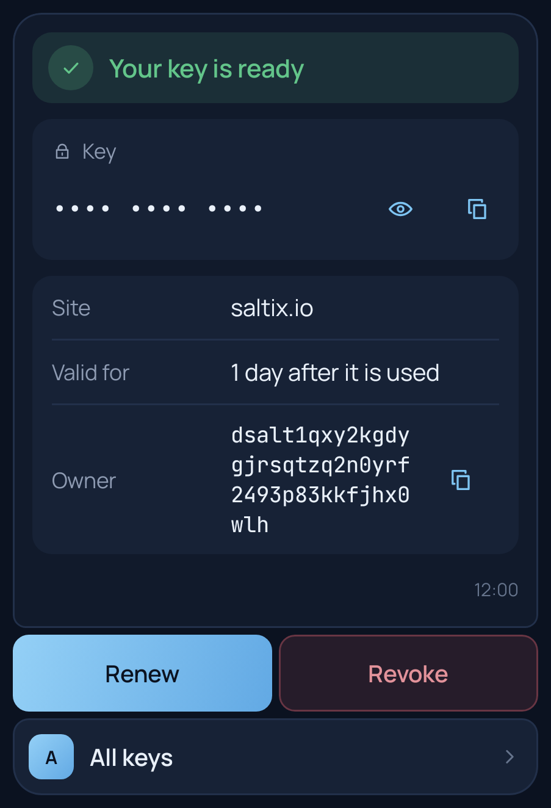
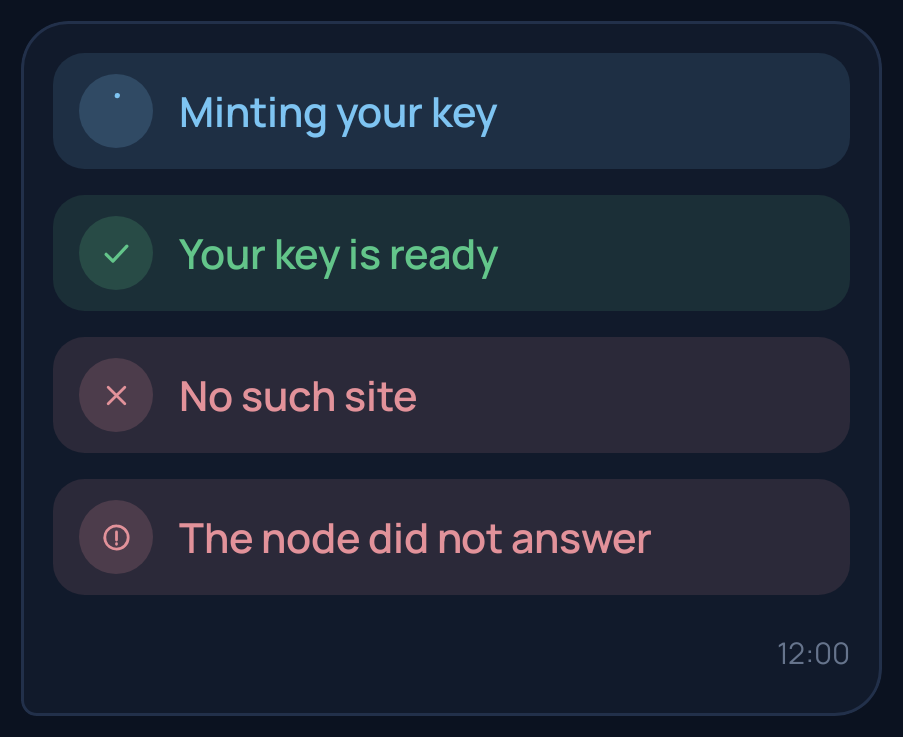
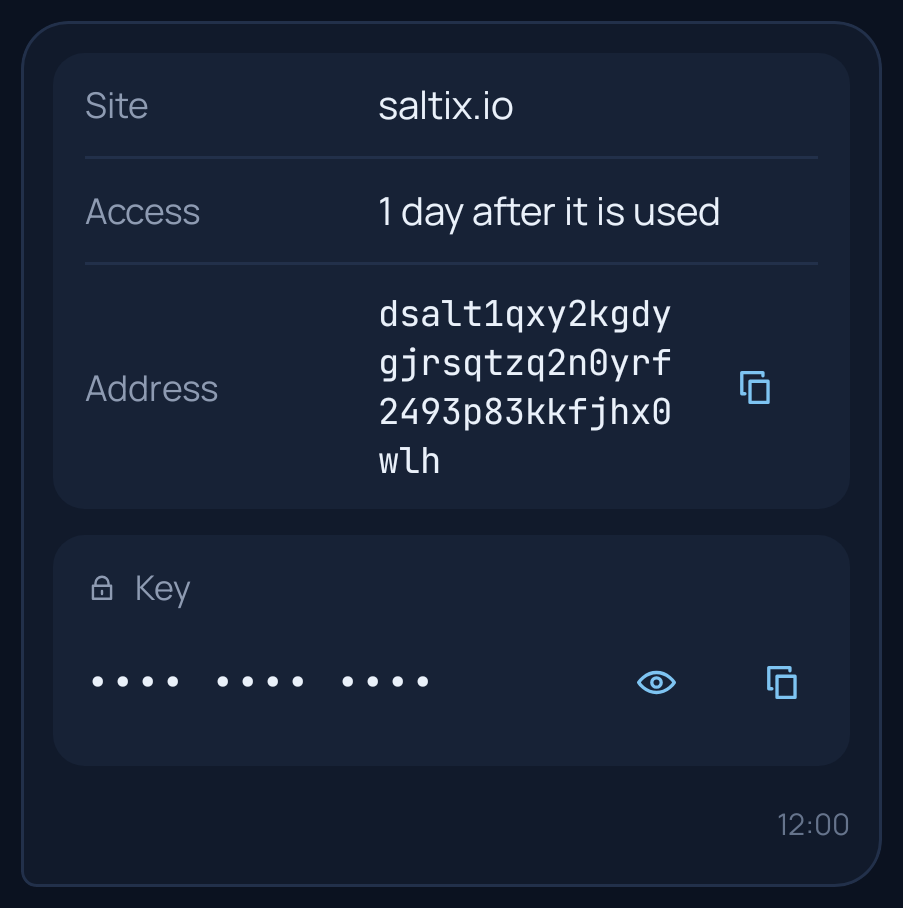
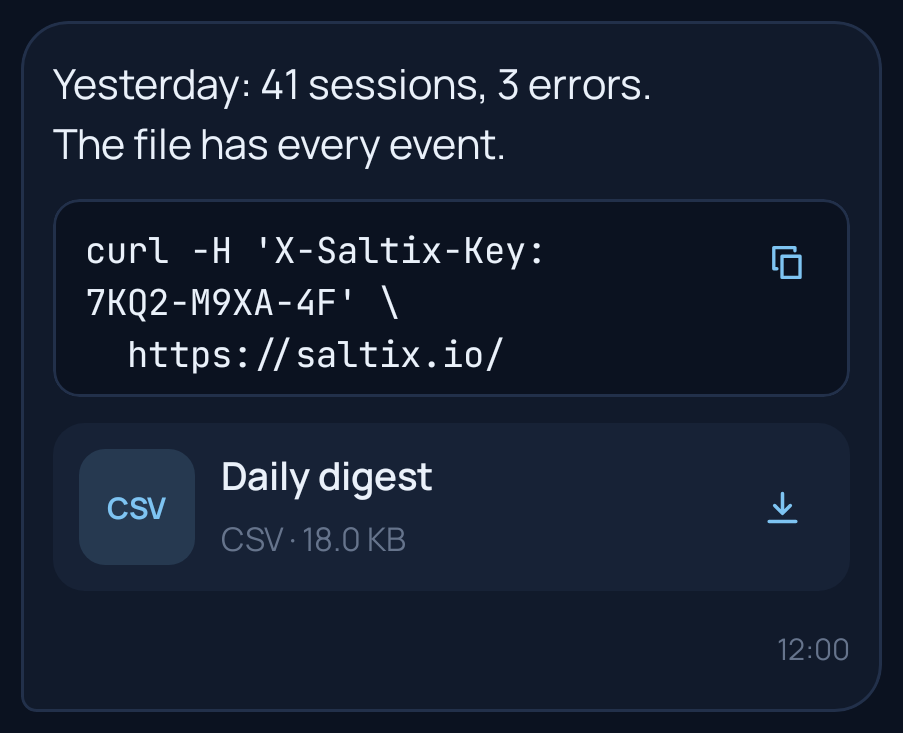
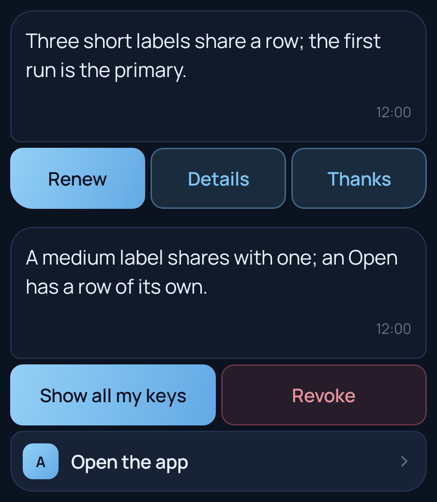
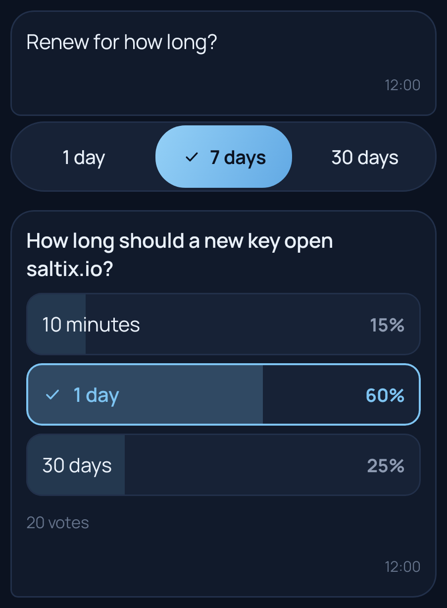
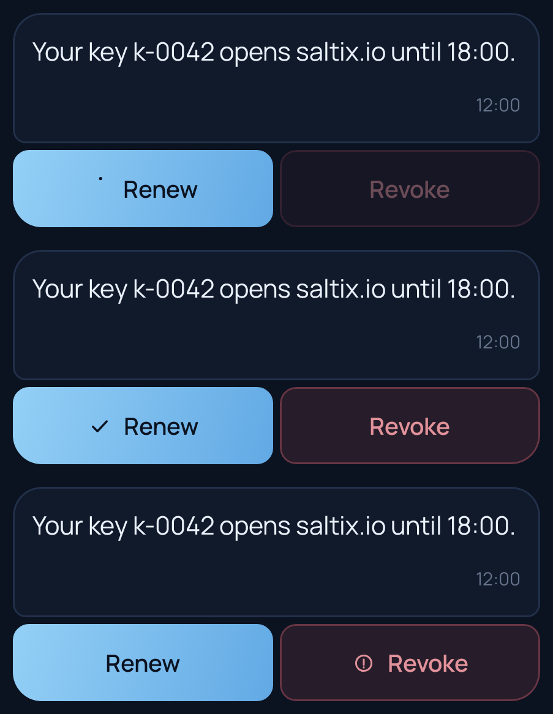

# Card design standard

Every Saltix draws an app's chat message the same way (Saltix
[22-grain-chats §5a](https://github.com/corvise/saltix/blob/main/specs/22-grain-chats.md)), so you design a card once
and it looks the same on a phone, on a foldable and in the app's own screen. This page is the standard: what each block
is for, how many actions a card takes and how they are laid out, which emphasis to choose, and what to avoid. `lintCard`
checks a card against it, and the simulator draws by it. The pictures are Saltix's own rendering.



## The anatomy

- **The capsule** holds your blocks, in your order, with the time and the "verified" mark at its foot.
- **The action bar** sits under the capsule, attached to it: full-width pill buttons in rows. Actions are never drawn
  inside the capsule.
- A card of text and statuses alone, without actions, is as wide as its text, like any message. Any other card takes
  the reading width, at most 400 dp.
- Colors, type and corners are Saltix's, in its light and dark themes. You choose the order, the words and the commands;
  the wallet does the rest.

## Blocks: which one for what

| Block | Use it for | Avoid |
|---|---|---|
| `status(state, text)` | where the request stands: `working`, `done`, `refused`, `failed`. It is the card's title: an icon, a color and your text | more than one a card (update it in place with `ask.working` and the answer), more than 60 characters, a status that is not first |
| `text(text)` | a sentence or two of what happened | markup (there is none), more than 8 lines (collapsed behind **More**), reports (send a file) |
| `fields({Label: value})` | facts that read as pairs: a site, a date, an amount, an id. A value of one word of 20+ characters (a key, an address, a hash) is drawn in monospace with Copy | more than 8 rows (send a `csv`), sentences as values |
| `secret(label, value, {expiresAt})` | what must not show in notifications or previews: an access key, a code. Masked until tapped, with Show and Copy | anything that is not secret (use `fields`) |
| `code(text)` | text to copy as it is: a command, a configuration, a log line. Monospace, Copy, never run | prose; more than 40 lines (send a file) |
| `file(ref, {format})` | a report or an export, as a tile with the format, size and Save. `png`, `jpg`, `jpeg`, `gif` and `webp` preview as a rounded image once downloaded | inlining a large table as text |
| `invoice(signed)` | a payment the user approves on the wallet's own sheet | asking for money in words |
| `poll(question, command, options, {chosen, closed, tally})` | a question with 2–6 answers; with `tally` it shows each option's share as a bar, the total and the user's vote; without it, a choice | more than one poll a card, more than 6 options, a question over 100 characters |







## Actions: how many, and how they are laid out

- **At most 6 actions, in at most 3 rows.** A card is a glance. Put everything else in the chat's commands (the
  composer lists them) or in your app's screen.
- **Rows follow the labels' length** (in characters):
  - up to 10 characters: three share a row;
  - up to 18: two share a row;
  - longer: a row of its own.

  A row takes the next action while every label in it allows one more; on a card narrower than 320 dp, two a row at
  most. An `open` always has a row of its own.
- **Keep labels short verbs**: "Renew", "Revoke", "All keys", "Details". 18 characters at most, 10 to share three a row.
- **Order is meaning.** The first `run` is the card's primary button, so put the action most people want first.



### Which emphasis

You never set an emphasis: Saltix infers it, the same in every wallet.

| Emphasis | What makes it | Use |
|---|---|---|
| **Primary**, filled | the first `run` that is neither destructive nor part of a choice | the action most users take next: Renew, Pay, Approve |
| **Secondary**, tinted | every other `run`, and every `reply` | the alternatives: Details, Later, Thanks |
| **Danger**, red, always asks "Send?" | a `run` whose command is named for it: the name, or its part before the first `_`, is `delete`, `remove`, `revoke`, `cancel`, `reset`, `wipe`, `erase`, `destroy`, `purge`, `ban`, `block`, `kick`, `reject`, `deny`, `disable`, `unsubscribe`, `unpublish` or `leave` | anything that destroys or takes back. Name the command so (`revoke_key`, not `key_revoke`), and mark it `confirm` in your spec too |
| **Choice**, one segmented control | two or three `run`s side by side for the same command, none destructive, whose labels fit one row | picking one of a few values: 1 day / 7 days / 30 days. The user's last pick stays selected |
| **The app**, with its icon | an `open` | opening your app's screen at a place |
| **The owner's panel** | a `publish` | proposing your app's update to its owner (only the team sees it) |

So: for "Approve" and "Reject", use two commands (`approve`, `reject_request`), not one command with a choice argument,
or they become a segmented control instead of a primary and a danger button. For four or more values, use a poll.



### What a tap does

- A `run` whose arguments fill its command's form **sends at once**: after "Send?" when the command is marked
  `confirm` or is destructive. One that leaves something to fill opens the form, filled with what you gave; a long
  press always opens the form, so the user can change the arguments first.
- A `reply` sends its text at once; an `open` opens your screen.
- After the tap, the button shows a spinner and the card's other actions wait (nothing goes twice). When your answer
  lands it shows a check, or a refused mark when your answer's status is `refused` or `failed`. A `working` status
  does not end the wait: the answer that replaces it does. After a minute without an answer the card takes taps again.



## Polls and choices

```ts
chat.command("lunch", () =>
  card().poll("Lunch on Friday?", "vote", [
    { label: "Pizza", args: { pick: "pizza" } },
    { label: "Sushi", args: { pick: "sushi" } },
    { label: "Salad", args: { pick: "salad" } },
  ]));

chat.command("vote", async (ask) => {
  tally[ask.args.pick]++;
  // In place of the poll the user tapped: the new counts and the user's own vote.
  await ask.update(card().poll("Lunch on Friday?", "vote", options(tally), { chosen: index(ask.args.pick), tally: true }));
});
```

- Each option runs `command` with its `args`, typed by your spec as a `run`'s. Your spec needs that command, with the
  parameters the options fill.
- You count the votes. Answer each vote with `ask.update(card)`: the poll again, with the new `votes`, `chosen` (the
  index of this user's vote) and `tally`. Saltix replaces the poll in place.
- Without a tally, and open, with at most 3 options of at most 12 characters, it is one segmented control; otherwise a
  list. With a tally, each option shows its whole-percent share as a bar; `closed` takes no more votes and says so.
- Show the tally after the user voted, not before, unless the numbers are the point.

## Older wallets

`code` and `poll` are new blocks. **Saltix 0.1.53 and older drop the whole message** that carries one (the frame does
not read), and nothing tells your server which Saltix a user runs. Use them once your users run a Saltix that draws them,
and keep a card that everyone must see to `status`, `text`, `fields`, `secret`, `file` and `invoice`. Older Saltix opens
the form on every `run`; the request is the same either way.

## The lint

```ts
import { lintCard, assertCardStandard } from "@saltix/grain-server";

lintCard(myCard, spec);              // [{ rule: "label", level: "warning", message: "…" }, …]
assertCardStandard(myCard, spec);    // in your tests: throws when a card breaks the standard
```

- `warning`: Saltix draws the card worse than it could: too many actions or rows, a long label, a status that is not
  first or too long, more than one status or poll, a table as fields, too many poll options, a command your spec does not
  have, four or more buttons of one command.
- `info`: worth knowing: the card uses a block older Saltix drops, a long text or code is collapsed, a destructive
  command is not marked `confirm`. `assertCardStandard(card, spec, { strict: true })` fails on these too.
- `ChatServer` logs each rule a sent card breaks once (`card_standard`), so you see it in development.

The rules themselves are exported (`cardLayout`, `isDestructive`, `pollLook`, `shares`, `perRow`, `isToken`) and
reproduce the protocol's cases in `vectors/grain-chats-v1.json` (`cards`).

## Do and don't

- **Do** put the status first and keep it to one line; put details in a text or fields under it.
- **Do** keep 1–3 actions on most cards; the first `run` is the one most people want.
- **Do** name destructive commands with their verb first, and mark them `confirm`.
- **Do** answer a tap: every `run` should get a card back, so the button's check means something.
- **Do** use `ask.update` for a poll's vote and for a card whose buttons change.
- **Don't** put more than 6 actions on a card, or labels over 18 characters.
- **Don't** send tables as fields or reports as text: send a file.
- **Don't** repeat what the wallet already shows: the app's name, "verified", the time.
- **Don't** use a `reply` for something your spec has a command for: a `run` is typed and checked before it leaves the
  phone.
